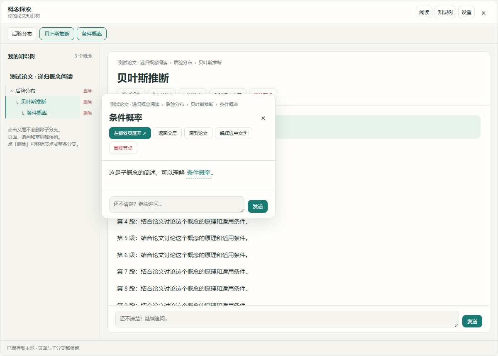
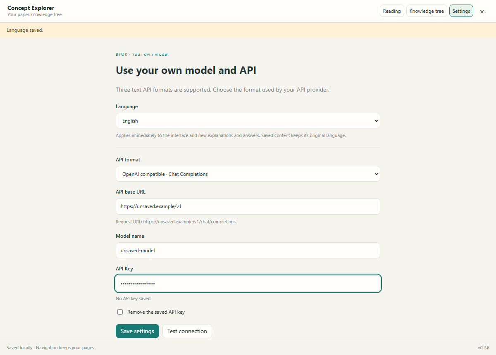

# 概念探索 · Concept Explorer

在 Zotero 中边读论文边理解概念：选中文字获得解释，沿着子概念继续追问，并把阅读过程保存为本地知识树。

[English](README.en.md) · [下载安装包](https://github.com/Purushka/zotero-concept-explorer/releases/latest) · [反馈问题](https://github.com/Purushka/zotero-concept-explorer/issues)



## 安装

1. 打开 [Releases](https://github.com/Purushka/zotero-concept-explorer/releases/latest)，在 **Assets** 中下载 `concept-explorer-0.2.8.xpi`。
2. 在 Zotero 中打开 **工具 → 插件**，将 `.xpi` 文件拖入插件窗口，或在齿轮菜单选择「从文件安装插件」。
3. 重启 Zotero，打开 **工具 → 概念探索 · 模型设置**。

请选择 `.xpi` 安装包；GitHub 自动生成的 `Source code.zip` 是源码，不能直接安装。升级时安装新版 `.xpi` 覆盖同一插件即可，无须删除知识树或重新创建模型设置。本版采用手动更新。

插件清单声明支持 Zotero **8–10**。本次实际验证环境为 **Windows / Zotero 10.0.6**；其他 Zotero 版本和 macOS、Linux 尚未逐一验证。

## 配置模型

插件使用你自己的模型服务和 API Key，安装包不附带模型、额度或 Key。

| 设置项 | 填写方式 |
| --- | --- |
| 接口格式 | 选择服务商实际支持的 Chat Completions、Responses 或 Anthropic Messages |
| 中转站地址 | 支持域名根地址、`/v1`、自定义前缀或完整接口地址；表单会预览实际请求地址 |
| 模型名称 | 填写所选服务提供的准确模型名 |
| API Key | 填写你自己的 Key 并保存；之后留空保存可保留原 Key |

保存后可主动点击「测试连接」。测试只发送一条短消息，不附带论文内容。解释、追问及连接测试可能产生模型服务费用。

远程接口需要 HTTPS，本机回环服务可以使用 HTTP。Responses 根地址会追加 `/responses`，明确填写 `/v1` 时使用 `/v1/responses`。不同服务的协议和模型权限各不相同。

## 怎么使用

1. 在 Zotero PDF 阅读器里选中一个概念或一句话，点击 **解释概念**。也可使用 `Ctrl+Alt+E` 解释最近的选词。
2. 先在小浮窗阅读简述，需要时点击 **在标签页展开** 查看详细解释。一次流式请求生成简述和详情，展开本身不会另发详情请求。
3. 点击解释里标记的概念，或在 AI 解释、AI 追问回答中划词，继续创建子概念。父层页面和子分支都会保留。
4. 在输入框继续追问；`Ctrl/Cmd+Enter` 可发送问题。不同概念独立保存对话、草稿和阅读位置。
5. 点击 **知识树** 回看历史，点击 **阅读** 恢复阅读现场。已有解释可以离线查看。

生成中的内容会作为临时预览显示，完整结束后才保存。停止、断流或服务报错时，原有完整解释和问题仍会保留。解释质量取决于所选模型与提供的上下文，重要结论请回到论文核对。

## 语言与浮窗

在设置顶部选择 **跟随 Zotero / 简体中文 / 繁體中文 / English**。选择立即生效并独立保存，重启后保留，无须先配置模型或 Key。

设置、阅读器按钮、工具菜单、知识树、解释浮窗和删除确认框会一起切换。新生成的解释和追问回答使用所选语言；已保存的解释、论文标题、概念名及草稿保留原文。自动跟随时匹配简体或繁体中文，其他暂未翻译的语言回退到 English。

按住浮窗标题栏左侧拖动，靠近 Zotero 内容区上下左右边缘松手可吸附。位置会保存，方向键也可移动；浮窗位于 Zotero 内部。



## 删除与备份

知识树每行和解释页都有删除入口，确认框默认选中取消。

- **仅删除此节点**：子节点上移一层，保留其解释、对话和草稿。
- **删除整条分支**：移除该节点及其后代，确认框会显示节点数量。

删除不会移除原论文。当前没有一键撤销；存档旁的 `.bak` 是上一次写入前的备份，会在后续保存时更新，重要知识树请另行备份。

## 数据与隐私

- API Key 保存在 Zotero/Mozilla 的本地登录凭据存储中，不写入知识树或导出文件，也不会在设置页回显。
- 解释请求会向你配置的模型服务发送选中文字、论文标题、可取得的附近原文和当前分支的父解释；追问包含当前节点的解释和对话。
- 插件不会自动上传整篇论文或整个文献库，没有额外的插件遥测服务。UI、Markdown、数学公式、字体和翻译资源均在本地打包。
- 知识树保存在 `[Zotero 数据目录]/concept-explorer/knowledge-tree.json`，使用独立文件、备份及原子写入。卸载插件不会删除它。
- 存档为本地明文，没有自动云同步或跨设备合并。损坏、未知格式和写入冲突会报错，不会自动清空存档。

## 开发

运行环境：Node.js **22.19+**，pnpm **10+**。

```sh
pnpm install --frozen-lockfile
pnpm test
pnpm build
```

构建结果位于 `dist/concept-explorer-0.2.8.xpi`，包含可编辑源码和第三方许可证。构建脚本会保留已有安装包；开发阶段只有确认是未发布测试包时才使用 `node scripts/build.mjs --replace-test-build`。

浏览器回归需要单独安装 Playwright 和 Chromium。测试默认从项目解析 `playwright`，也可通过 `PLAYWRIGHT_MODULE_PATH` 指定已安装的 Playwright 模块，通过 `CHROMIUM_EXECUTABLE_PATH` 指定浏览器：

```sh
pnpm test:ui
pnpm test:deletion-ui
pnpm test:floating-ui
pnpm test:language-ui
```

Windows 原生测试入口为 `node tests/gecko-rollback/run-isolated.mjs`，可通过 `ZOTERO_EXECUTABLE` 指定 Zotero。该测试使用独立临时 profile、虚构文献、假 Key 和本地模拟接口，不使用日常文献库。

0.2.8 的功能验证包括 **121 项 Node 测试、66 项 Chromium 检查、29 项 Zotero 原生检查**。这些验证不代表真实付费 API 的可用性或模型回答质量。发布记录见 [0.2.8](docs/releases/v0.2.8.md)；验证范围见 [VALIDATION.md](VALIDATION.md)。

## 许可证与复用

[AGPL-3.0-or-later](LICENSE)。复用的组件包括 p-limit、yocto-queue、markdown-it、Floating UI、eventsource-parser、jsonrepair、KaTeX、texmath、interact.js 和 i18next。版本、来源和本地改动见 [vendor/NOTICE.md](vendor/NOTICE.md)，第三方许可随源码和安装包保留。
